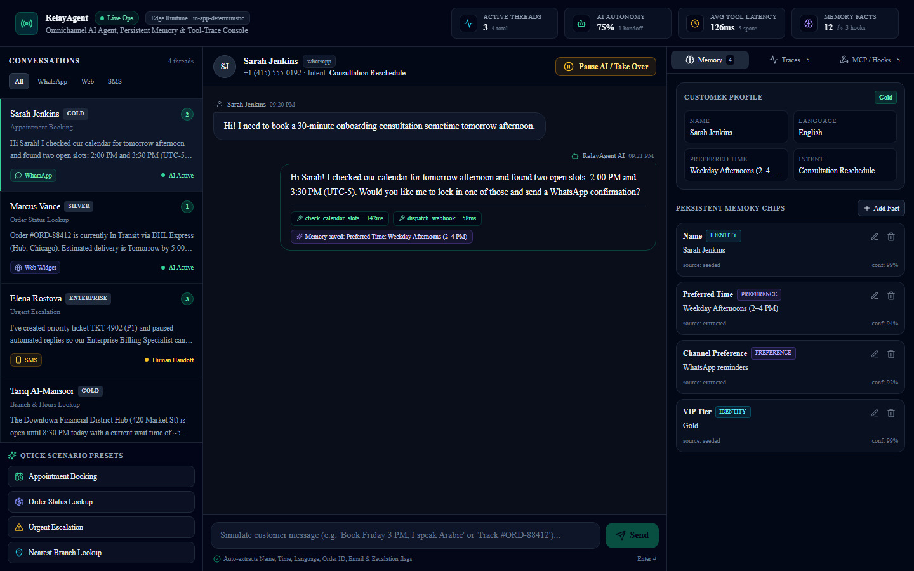
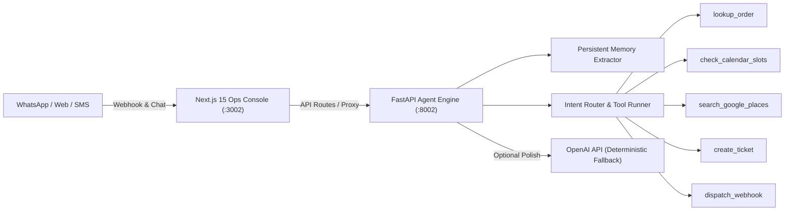

# RelayAgent — Omnichannel AI Agent & Memory Ops Console

**RelayAgent** is a full-stack operations console for managing autonomous AI support and booking agents across **WhatsApp**, **Web Widget**, and **SMS** — featuring persistent customer memory extraction, live MCP/webhook tool-execution tracing, and instant human handoff controls.



## Architecture



> **Zero-Dependency Vercel Deploy:** When `FASTAPI_URL` is unset, the Next.js API routes automatically run the built-in TypeScript intent router, memory extractor, and tool trace engine so `frontend/` deploys standalone with 100% interactivity.

## Key Features

- **3-Column Enterprise Ops Workspace:** Channel-filtered conversation inbox (`WhatsApp`, `Web Widget`, `SMS`), live chat simulator with one-click scenario presets, and a tabbed telemetry inspector.
- **Live Human Handoff Control:** Toggle **Pause AI / Take Over** vs **Resume AI** per thread. When paused, inbound customer messages still extract memory facts while suppressing autonomous AI replies so human operators can reply directly.
- **Persistent Customer Memory:** Automatically extracts and persists structured facts (`Name`, `Preferred Time`, `Language`, `Order ID`, `Email`, `Channel Preference`, `Escalation Flag`) with inline manual add, edit, and delete controls.
- **Tool-Execution Trace Viewer:** Waterfall view of every tool call (`200 OK`, `201 CREATED`, `409 DISABLED`), latency bars in ms, `X-Request-ID` correlation, and expandable JSON input/output payloads.
- **Toggleable MCP Tool Registry & WhatsApp Webhook Ingestor:** Enable/disable individual tools live to observe graceful degradation, and fire simulated inbound WhatsApp Cloud API webhooks directly into active threads.

## Local Setup

### Option 1: Docker Compose (Recommended)

```bash
cp .env.example .env
docker compose up --build
```

- Frontend Ops Console: `http://localhost:3002`
- FastAPI Backend & Swagger Docs: `http://localhost:8002/docs`

### Option 2: Run Locally

**Backend (Python 3.11+):**
```bash
cd backend
python -m venv .venv
source .venv/bin/activate  # Windows: .venv\Scripts\activate
pip install -r requirements.txt
uvicorn main:app --reload --port 8002
pytest -v
```

**Frontend (Node 20+):**
```bash
cd frontend
npm install
npm run dev
```

## API Reference

All responses follow a unified envelope (`request_id`, `timestamp`, `data`) with `X-Request-ID` header propagation.

| Method | Endpoint | Description |
|---|---|---|
| `GET` | `/health` | Service status, thread/trace counts, active LLM mode |
| `GET` | `/api/v1/threads` | List active omnichannel threads sorted by recent activity |
| `POST` | `/api/v1/threads/{id}/messages` | Run agent turn (memory extraction + tool execution + reply) |
| `POST` | `/api/v1/threads/{id}/handoff` | Toggle AI autonomous handling vs human operator takeover |
| `GET` | `/api/v1/threads/{id}/memory` | Fetch structured customer profile and memory facts |
| `POST` | `/api/v1/threads/{id}/memory` | Manually add or update a persistent memory fact |
| `DELETE` | `/api/v1/threads/{id}/memory/{fact_id}` | Delete a memory fact from the customer profile |
| `GET` | `/api/v1/traces` | Retrieve tool-execution waterfall spans (filterable by `thread_id`) |
| `GET` / `PATCH` | `/api/v1/tools` | Inspect or toggle MCP/webhook tools in the live registry |
| `POST` | `/api/v1/webhooks/whatsapp` | Verified inbound WhatsApp webhook payload ingestor |
